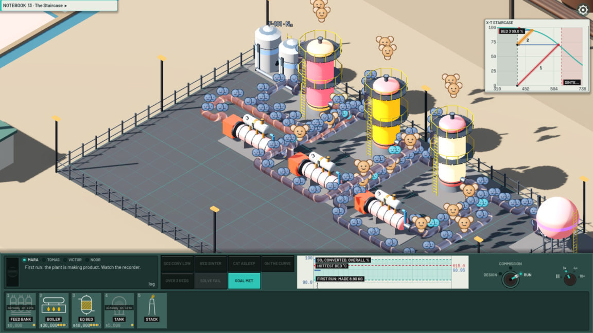
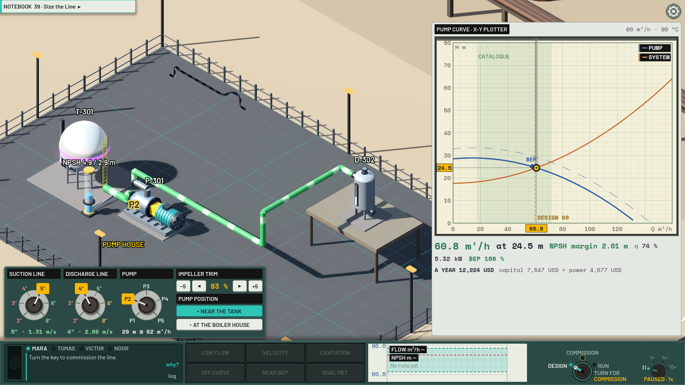
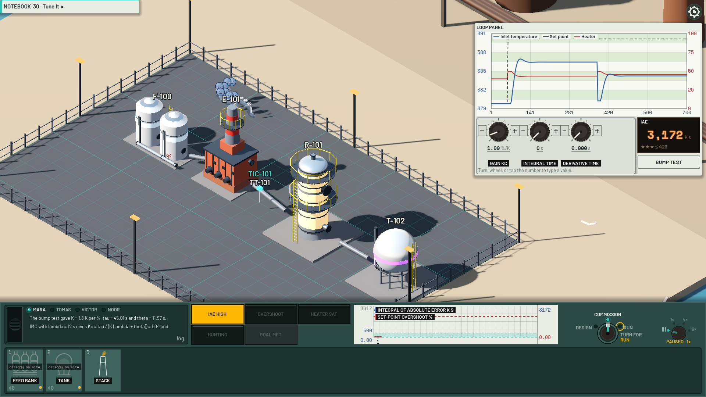
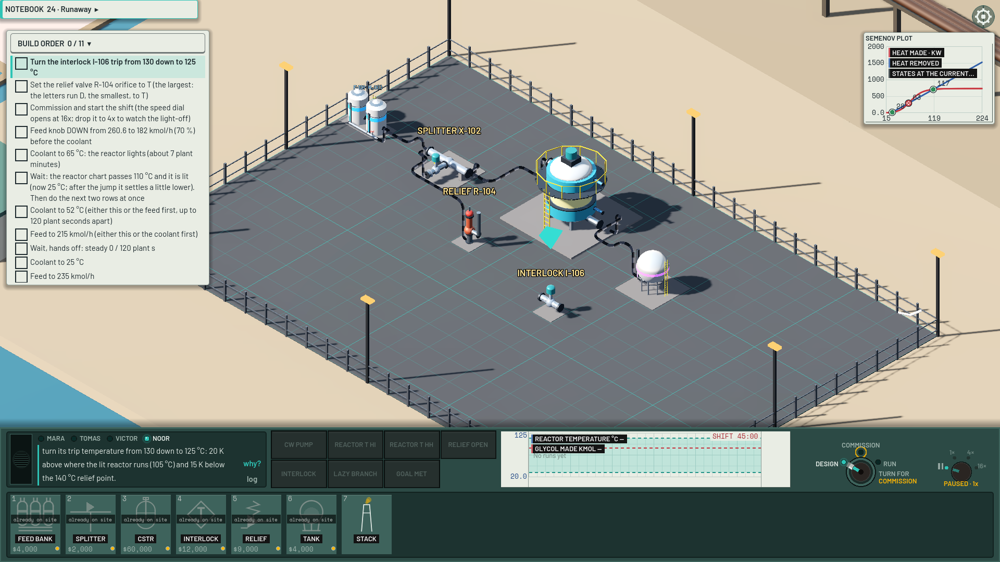
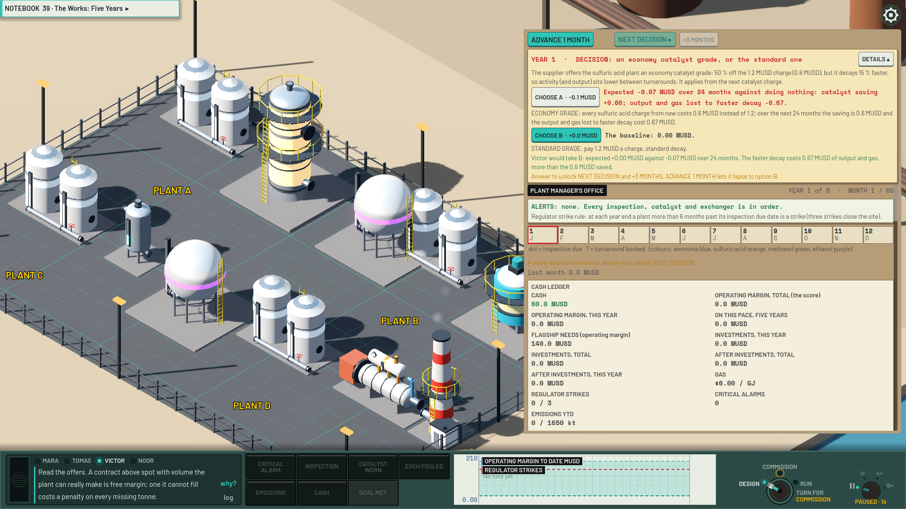
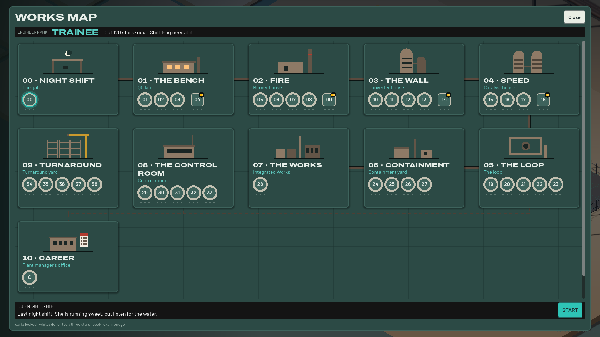

# ⚗️ EQUILIBRIUM — run a chemical plant where the chemistry is real

**[Releases](https://github.com/blackmetaltech/equilibrium/releases)** · **[Changelog](CHANGELOG.md)** · **[Critique](docs/CRITIQUE-0.9.md)** · **[Issues](https://github.com/blackmetaltech/equilibrium/issues)**

**Build a chemical plant, then find out whether it works.** Place feed banks, heaters, exchangers, burners, reactors, columns and recycle loops, pipe them together, and commission the plant. Then real equilibrium, real kinetics and real heat balances decide what happens: the ammonia you can reach at 450 °C and 200 bar, the catalyst that falls asleep below 410 °C, the glycol reactor that crosses its Semenov point and runs away, the argon that builds up in a loop with no purge. The campaign climbs from std-9 stoichiometry to the work of a junior process engineer: PID tuning, interlocks, HAZOP, data reconciliation, and a five-year career running a whole Works.

The front-end is a **Godot 4.7** game drawn as a 1970s control room: annunciator windows, a chart recorder, Bakelite knobs, a DESIGN / COMMISSION / RUN key switch, a green-bar printout. Every rule (thermodynamics, equilibrium, kinetics, flowsheet solving, dynamics, economics) runs in a deterministic TypeScript engine (on a shared core) that Godot drives through a headless Node sidecar.

> **Alpha (0.9.0).** Playable on desktop Linux; that is the only platform really supported so far (a Windows zip is built but untested). An Android debug APK builds locally, and there is a Steam Deck (1280×800) layout. Rough in places: see the [changelog](CHANGELOG.md) and the known gaps below. Tell us what broke or confused you in [issues](https://github.com/blackmetaltech/equilibrium/issues).



## What's new in 0.9

| L39: the pump house is the instrument (pipes at their size and coloured by velocity, the NPSH sight-glass, the X-Y plotter, selector knobs) | The same job cavitating: a 2-inch suction from the boiler house |
|---|---|
|  |  |


0.9 makes the plant readable: every text is 16 px or more, the camera frames the equipment, and the parts tray gets out of the way. The Career fits the window after a resume, grades a call at the first commission, announces the incident a month ahead and asks twice before it spends. Details in the [changelog](CHANGELOG.md).

## What you actually do

| | |
|---|---|
| **Design** | Pick units from the P&ID parts rack (feed banks, mixers, heaters, coolers, exchangers, compressors, reactors, flash drums, columns, absorbers, boilers, stacks, relief valves, interlocks), place them on the plot and pipe them. Each unit has a faceplate with Bakelite knobs. |
| **Commission** | Turn the key. The flowsheet solver settles the whole plant (recycle loops included) and the stream tags show composition, flow, T and P. |
| **Run** | Shift levels run the plant in time on the chart recorder, with an ISA-18.2 style annunciator and the intercom voices of Mara, Tomas, Victor and Noor: dry and exact, practical, money, and sober. Stop, edit and run again; your build is kept. |
| **Call it** | Predict a number before you commission (the H₂ you must buy, K at 450 °C, the adiabatic rise). The printout compares your call with the engine's. |
| **Instruments** | The **Equilibrium Window** and balance beam, the **X-T staircase**, the **Semenov plot**, the **heat ledger** and the **loop panel** with a green-bar strip chart, tuning knobs and a Nixie readout. |
| **Turnaround boards** | A HAZOP worksheet, start-up SOP cards, permit to work, a data-reconciliation logsheet and a planning board with crew and crane levelling. |
| **Hydraulics** | Size a pipe and pick a pump: the system curve against the pump curve, NPSH and cavitation, and the cheapest line over a year. |
| **Career** | Five seeded years running the Works: contracts, price walks, catalyst decay, fouling, wear, inspections, turnarounds, incidents, emissions caps, investments, and an annual review. When inerts creep into the ammonia feed you can go to the plant and fix the purge yourself, call a contractor or ignore it. |

**The campaign.** Twelve stops on the **Works Map**, 40 levels plus the Career. **Night Shift** is a cold open at 02:40 on an ammonia loop. **The Bench** (L01-L04) is moles, not kilograms, air is mostly nitrogen, the unknown fuel, and a lab-notebook exam bridge. **Fire** (L05-L09) is waste-heat boilers, a burner lining limit, Hess's road, paying once for heat, and bomb vs flow calorimeter. **The Wall** (L10-L14) is Le Chatelier with the rigorous K, gas contracts with inerts, a water-gas shift where pressure does nothing, the SO₂ staircase and the brown N₂O₄ gas. **Speed** (L15-L18) is rate vs ceiling, light-off, a faster road to the same destination, and an oxygen rig. **The Loop** (L19-L23) is recycle, purge, refrigerated flash, the methanol loop and a distillery. **Containment** (L24-L27) is runaway, the last 0.3 percent, the nitric acid gauze deck and a blocked outlet. **The Works** (L28) feeds the world with ammonia from natural gas. **The Control Room** (L29-L33) is PID, a bump test and IMC tuning, ratio, cascade and an interlock with voting. **Turnaround** (L34-L38) is HAZOP, start-up, permit to work, reconciliation and a 20-day planning window. **Hydraulics** (L39) is a condensate line to size, with five pumps and a cavitating suction to avoid. **Career** (C) is five years in charge. Exam bridges sit at the end of chapters 1 to 4.

**Modes.** **Learner** (coach, auto-explanations, gentler events, costs never fail a goal), **Engineer** (rigorous, costs and emissions can fail goals) and **Sandbox** (all units and species, no goals). Stars on the map count toward an Engineer rank.

**Honest by design.** The thermodynamics come from NIST Shomate polynomials (NASA 7-term where NIST has none), checked against JANAF to about 0.01 kJ/mol, with equilibrium constants from the rigorous Gibbs route. A suite of oracle tests (hand-checkable values, JANAF fixtures, property tests on the solvers, analytic PID and FOPDT responses) pins the numbers, and a level's own numbers appear in the lesson text rather than generic ones. The engine is deterministic: every `exp`, `log` and `pow` goes through the core's fdlibm math, the random streams are seeded per level, and a run replays exactly. What is simplified is written down in [docs/DESIGN.md](docs/DESIGN.md): gases are ideal at every pressure (a Pitzer virial gauge flags how far off that is), the nitric acid absorber has a fixed recovery, the relief model is API 520 with K_b = K_c = 1, and some bench prices are game numbers rather than quotes.

**Cute mode.** Turn it on from the title or the pause menu (it is on by default). Every pipe fills with molecule critters, and the picture is the physics: the number of critters of each species follows its **molar flow** (largest remainder over the mole fractions), their size follows **M^⅓**, and their pace follows the flow. A light gas such as hydrogen makes many small critters and a heavy one a few big ones. Gulls, flamingos, the QC-lab cat and the old Works wander the site. Switch it off for the plain control room.

## Screenshots

| Night Shift (L00): the Equilibrium Window and balance beam | Notebook brief, goals, budget and flasks (L16) |
|---|---|
|  |  |
| **A run that went wrong: the printout says why (L01)** | **Runaway (L24): Semenov plot, running** |
|  |  |

## The control room and the boards

| Tune It (L30): bump test, IMC, Nixie IAE | The Interlock (L33): sensors, votes, trip point |
|---|---|
|  |  |
| **HAZOP Node (L34)** | **The Analyser Lies (L37): data reconciliation** |
|  |  |

## Guidance you can follow

| The build order checklist (L24 start-up): every row ticks from the plant itself and stays up while the plant runs | Career: one decision a year, every option with the terms that make up its MUSD |
|---|---|
|  |  |

## The Works

| The Works Map | Career: year 2 of 5 |
|---|---|
|  |  |

## On a Steam Deck

The handheld layout (1280×800) keeps the loop panel and the console on screen together.


## Download

There is **no public release yet**. The repository is private and a release needs the owner's go-ahead (the release workflow publishes the `[x.y.z]` section of the changelog on a `v*` tag). Until then:

- **Desktop Linux**: run from source (below).
- **Android**: `core/qa/buildapk.sh` builds a **debug** APK for arm64 (`build/android/EQUILIBRIUM-debug.apk`); the engine runs in-process on nodejs-mobile. It is a local build, not a store build.

## Run from source

Needs **Node.js 18+**, pnpm and **Godot 4.7**.

```sh
git clone --recursive <this repo>        # or: git submodule update --init
pnpm install
pnpm bridge                              # builds the engine sidecar -> godot/sidecar/bridge.mjs
godot --headless --path godot --import   # once, and after adding class_name scripts
godot --path godot                       # play
```

| task | command |
|---|---|
| typecheck | `pnpm typecheck` |
| unit, golden, persona and level tests | `pnpm test` |
| regenerate goldens (deliberate rule change only) | `GOLDEN_UPDATE=1 pnpm test` |
| UI smoke (every screen) | `pnpm smoke` (prints `SMOKE OK`) |
| screenshots and play-testers | `core/qa/README.md` |
| Android debug APK | `core/qa/buildapk.sh` (see `core/android/README.md`) |

Environment hooks for testing (`CB_AUTOSTART=learner`, `CB_LEVEL=L24`, `CB_CUTE=0|1`, `CB_SHOT=out.png`) are listed in `core/godot/addons/cobanana/README.md`. Where things go: `core/CORE.md`. Game design: [docs/DESIGN.md](docs/DESIGN.md).

## Architecture

```
core/        cobanana-core (git submodule): deterministic kit, Node bridge, Godot shell addon, Android runner, QA scripts
src/
  data/      species, reactions, kinetics, catalysts, equipment, VLE (generated from NIST / JANAF, provenance-tested)
  sim/       chem (equilibrium, kinetics), thermo, units, flowsheet (sequential-modular, Wegstein),
             dynamics, control (PID / FOPDT), ops, career, econ, explain
  engine/    actions, queries and the instrument queries the game calls
  levels/    one file per level (L00-L38, Career) with its tests; locales/en holds the text
  oracle/    JANAF and analytic fixtures
godot/       the game: main.gd, world/ (plant, pipes, critters, models), ui/ (console, faceplates, boards, instruments), tests/
docs/        DESIGN, DECISIONS, CRITIQUE-0.3 … CRITIQUE-0.7, readme screenshots, research
```

## Status and known gaps

0.9 ("The plant you can read") is tagged. The Career fixes from round 11 are in, the pump house and the incident are things in the plant, and a layout test walks every screen and level at 1920x1080 and 1280x800 for text under 16 px, clipping and overlap. Still open, from the [critique](docs/CRITIQUE-0.9.md) and `.work/backlog.md`:

- **Gamepad**: a pad-only pass at 1280x800 found the game only partly playable by pad (the notebook's call-it, the loop-panel knobs, the key switch, the speed dial and the Career's yearly choices are out of reach, and the focus ring is faint in places).
- **Career**: no careful human has finished all 60 months on this build, and the board still repeats the incident warning three times.
- **Phone**: checked on desktop at phone size only; the device needs the owner's adb authorisation.
- Releases are pre-releases: a Linux build (smoke-tested) and a Windows zip (untested); no macOS build, and the Android APK is a debug build.
