# ⚗️ EQUILIBRIUM — build a chemical plant, turn the key, read what it makes

**[Releases](https://github.com/blackmetaltech/equilibrium/releases)** · **[Changelog](CHANGELOG.md)** · **[Critique](docs/CRITIQUE-0.13.md)** · **[Site](https://equilibrium.blackmetal.tech)** · **[Issues](https://github.com/blackmetaltech/equilibrium/issues)**

**Build a chemical plant and turn the key. Equilibrium, kinetics and heat decide if it works.**

A **Godot 4.7** game with the chemistry engine in TypeScript.

> **Alpha (0.13.0).** The prologue and chapters 1-4 are in the new look. Played on Linux; Windows and macOS untested.

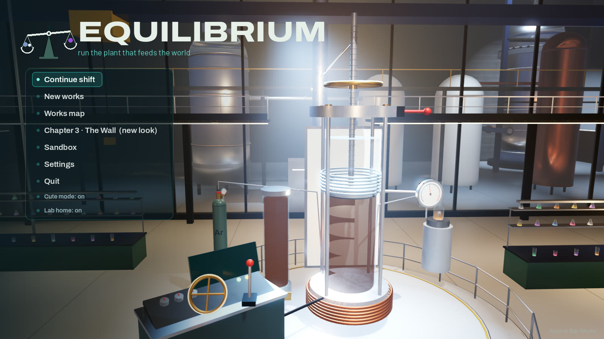

## What's new in 0.13: inside the bed

**The packed bed has a quartz window.** Ceramic balls sit over and under the catalyst, iron pellets grey, V2O5 pellets brown. More catalyst is a deeper bed. The pellets glow by the temperature down the bed, and five thermowells read it in °C.

| L15: the bed through its window, the thermowell readings beside it | L18: a glass kettle of peroxide with a head of foam (catalase: the most) |
|---|---|
| 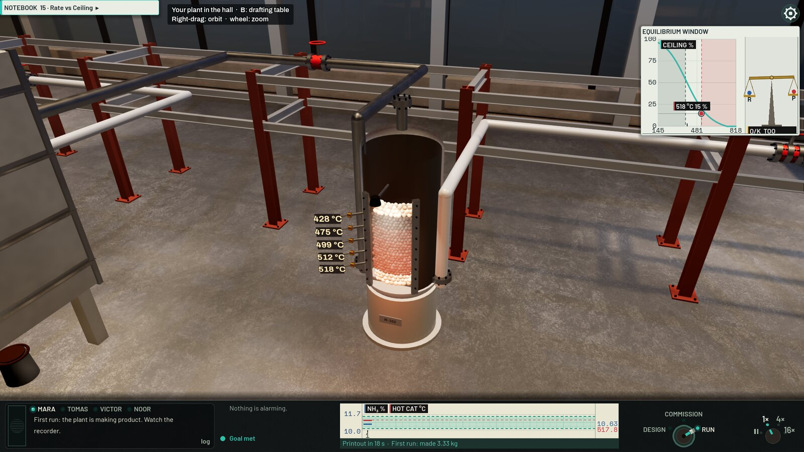 | 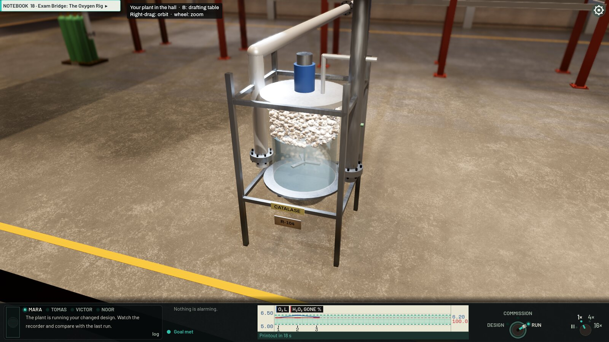 |

**L09 is a lab bench in the hall.** A flow calorimeter in a water jacket, a bomb calorimeter and a clamshell tube furnace whose ends glow with its temperature. Chapter 2 is whole in the new look.

| L09: the bench with the furnace reading 361 °C | The Works map: a scale model on the planning table |
|---|---|
| 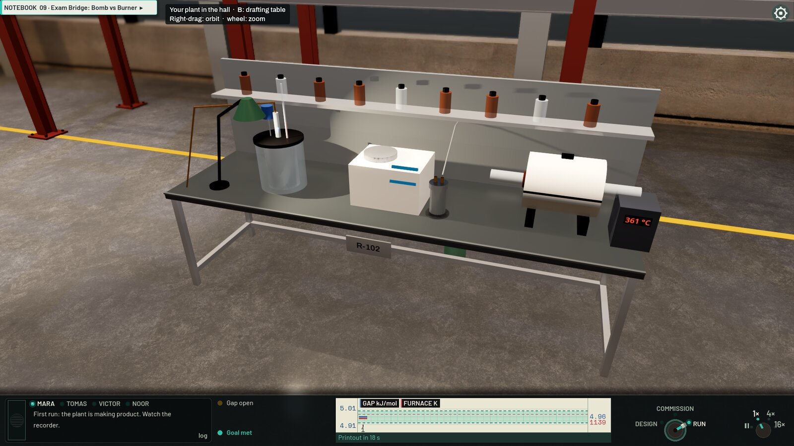 | 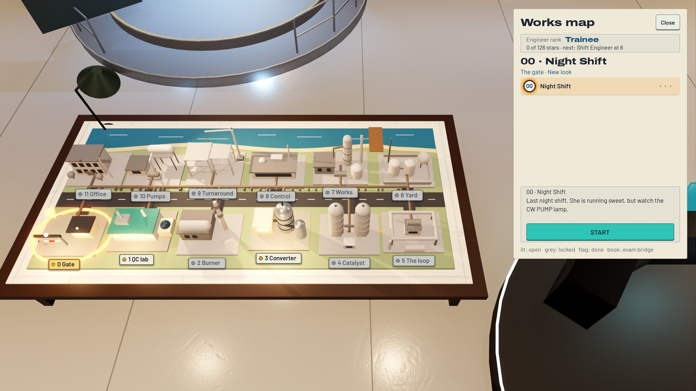 |

**The Works map is a scale model.** One building per stop, lit when open, grey when locked, a flag when done. The brief has a pencil sketch of the plant you will build.

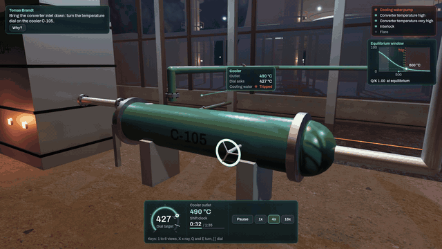

**The hall console is smoked glass** and the banner says how to orbit and zoom. The recorder follows the plant during a first run.

## What was new in 0.12: the lab at home

**The lab is the home screen.** The title, the Works map and the briefings live in your private lab. The map and the brief lie on a drafting table.

| Your sulfur burner in the hall: a drum on saddles, its fan and burner front, the peep window lighting the floor | L08: the fired heater and the feed-effluent exchanger |
|---|---|
| 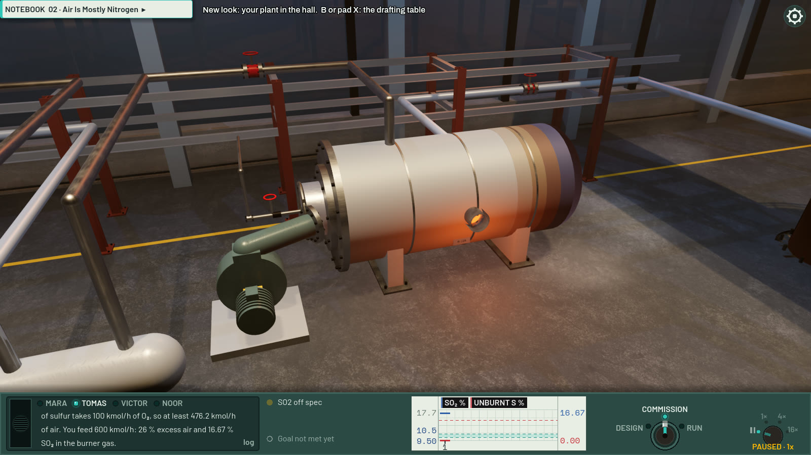 | 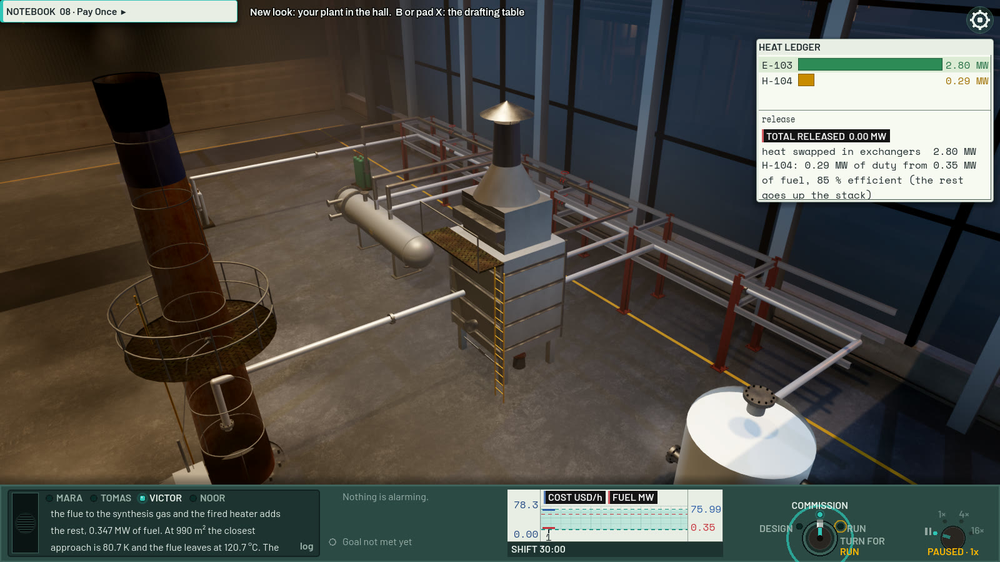 |

**Chapter 2 builds in the hall.** L05-L08 get a splitter, a gasifier, a CO burner, a fired heater, an exchanger and a cooler. L09 is still classic.

**Equipment you can read.** Dished heads, nozzles, cages, saddles, an I-beam rack behind the plant, beds that glow red to orange with temperature. Each level has its own camera.

**Plain text.** Short briefs, prompts that name your device, no all-caps chips.

## What was new in 0.11: chapter 1 in the new look

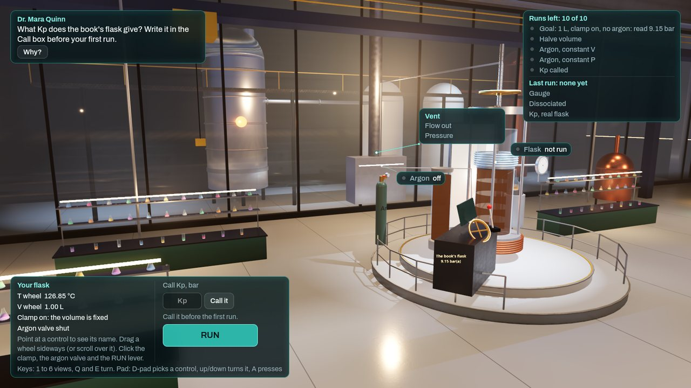

**L14 has a goal you can miss.** Find the temperature where your flask reads the book's 9.15 bar, and show why with one argon test. Six runs.

**Chapter 1 joins the hall.** Your bench plant, the sulfur burner and the boiler stand in 3D once they run.

| Your L13 plant in the hall: a catalyst bed glowing at its band, a boiler steaming behind | The flue analyser reads the engine's own gas, wet basis |
|---|---|
| 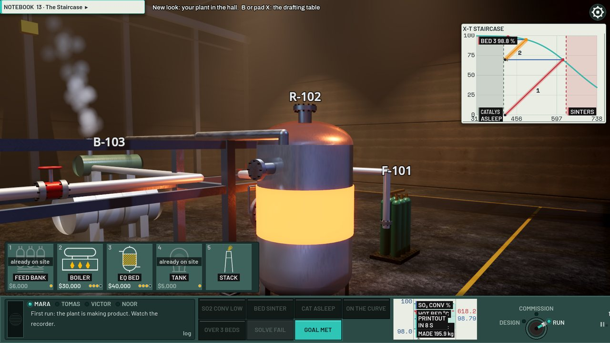 | 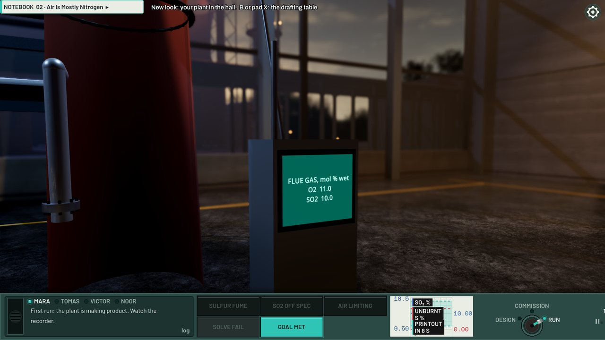 |

**Pad everywhere.** The drafting table now plays by gamepad alone. **Sound.** The plant hums, roars and hisses with its state; no human has listened yet.

## What was new in 0.10: chapter 3 in the new look

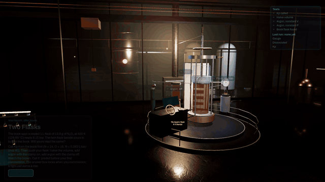

**L14 Two Flasks** is your own experiment: N₂O₄ on NIST-JANAF data beside a flask built to the textbook. Turn the wheels, run, and find where they agree.

| The lab | The rig: wheels, lever, argon valve, clamp, gauge |
|---|---|
| 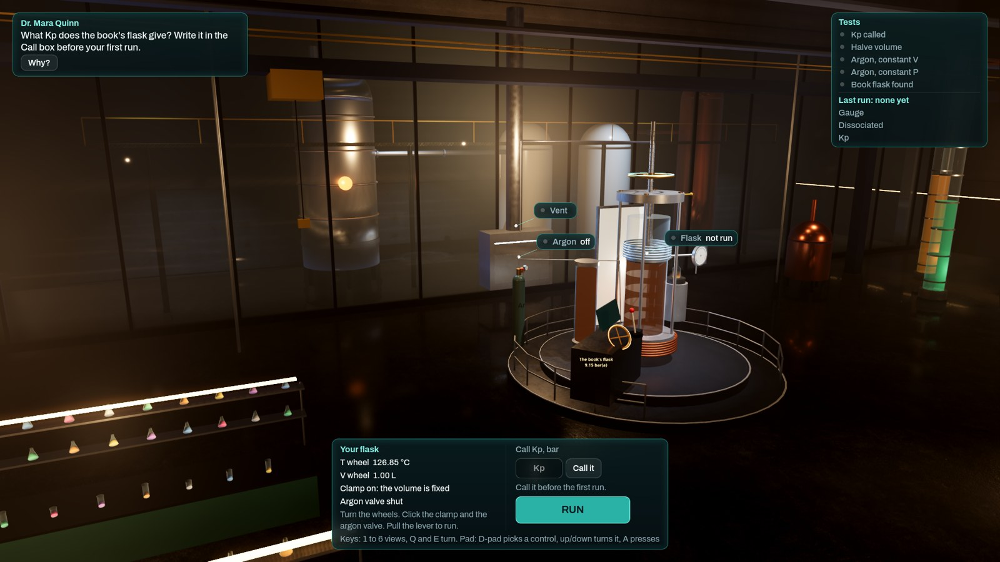 | 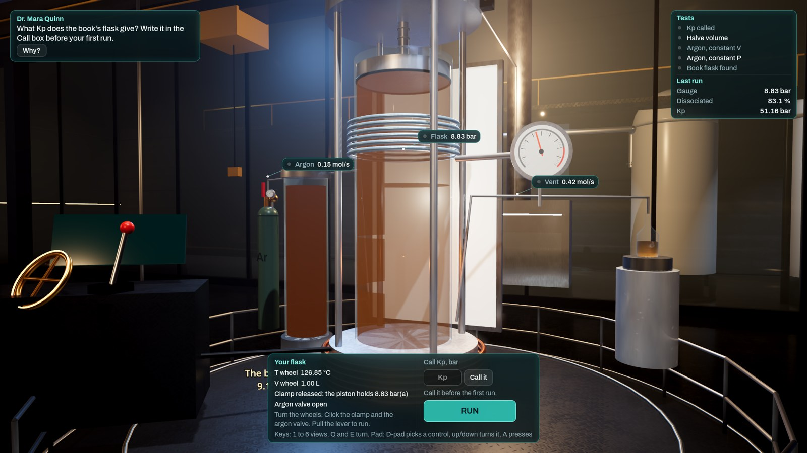 |

| L10-L13: the player's own commissioned plant in the hall (beds glow by outlet temperature; boilers steam by duty) | Night Shift: leave the cooler alone (or turn it too late) and the interlock trips the loop |
|---|---|
| 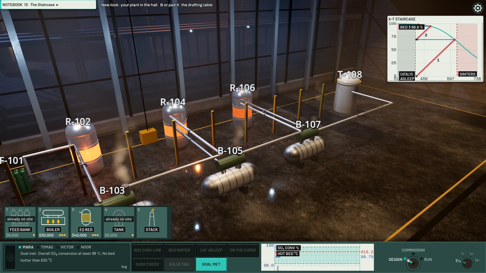 |  |

**New and classic.** The Works map labels each chapter New look or classic.

## What was new in 0.9

| L39: the pump house is the instrument (pipes at their size and coloured by velocity, the NPSH sight-glass, the X-Y plotter, selector knobs) | The same job cavitating: a 2-inch suction from the boiler house |
|---|---|
|  | 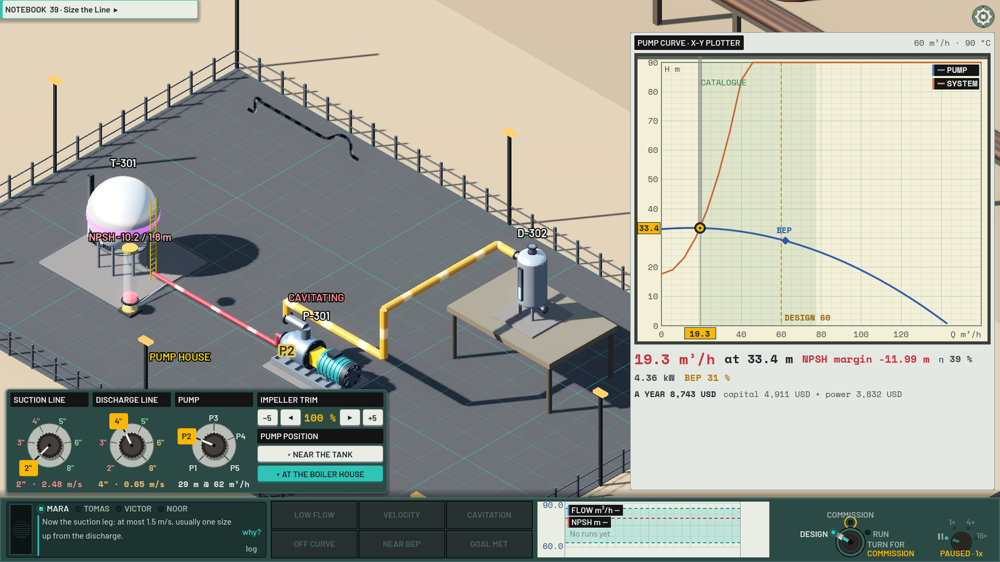 |

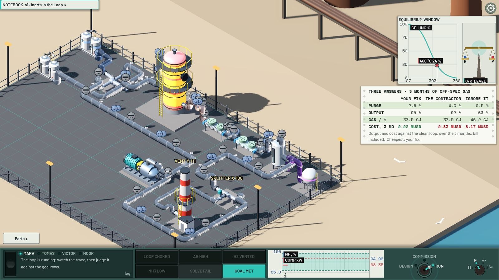

0.9 made every text 16 px or more and the Career trustworthy.

## What you actually do

| | |
|---|---|
| **Design** | Pick units from the P&ID parts rack (feed banks, mixers, heaters, coolers, exchangers, compressors, reactors, flash drums, columns, absorbers, boilers, stacks, relief valves, interlocks), place them on the plot and pipe them. Each unit has a faceplate with Bakelite knobs. |
| **Commission** | Turn the key. The flowsheet solver settles the whole plant (recycle loops included) and the stream tags show composition, flow, T and P. |
| **Run** | Shift levels run the plant in time on the chart recorder, with an ISA-18.2 style annunciator and the intercom voices of Mara, Tomas, Victor and Noor: dry and exact, practical, money, and sober. Stop, edit and run again; your build is kept. |
| **Call it** | Predict a number before you commission (the H₂ you must buy, K at 450 °C, the adiabatic rise). The printout compares your call with the engine's. |
| **Instruments** | The **Equilibrium Window** and balance beam, the **X-T staircase**, the **Semenov plot**, the **heat ledger** and the **loop panel** with a green-bar strip chart, tuning knobs and a Nixie readout. |
| **Turnaround boards** | A HAZOP worksheet, start-up SOP cards, permit to work, a data-reconciliation logsheet and a planning board with crew and crane levelling. |
| **Hydraulics** | Size a pipe and pick a pump: the system curve against the pump curve, NPSH and cavitation, and the cheapest line over a year. |
| **Career** | Five seeded years running the Works: contracts, price walks, catalyst decay, fouling, wear, inspections, turnarounds, incidents, emissions caps, investments, and an annual review. When inerts creep into the ammonia feed you can go to the plant and fix the purge yourself, call a contractor or ignore it. |

**The campaign.** Twelve stops on the Works Map, 40 levels and a five-year Career.

**Modes.** Learner has a coach and gentler events; Engineer is rigorous.

**Honest by design.** NIST and JANAF data, tested against independent oracles; the codex names every simplification.

**Cute mode.** Molecule critters fill the pipes. It is on by default.

## Screenshots (classic look)

| Night Shift (L00): the Equilibrium Window and balance beam | Notebook brief, goals, budget and flasks (L16) |
|---|---|
|  | 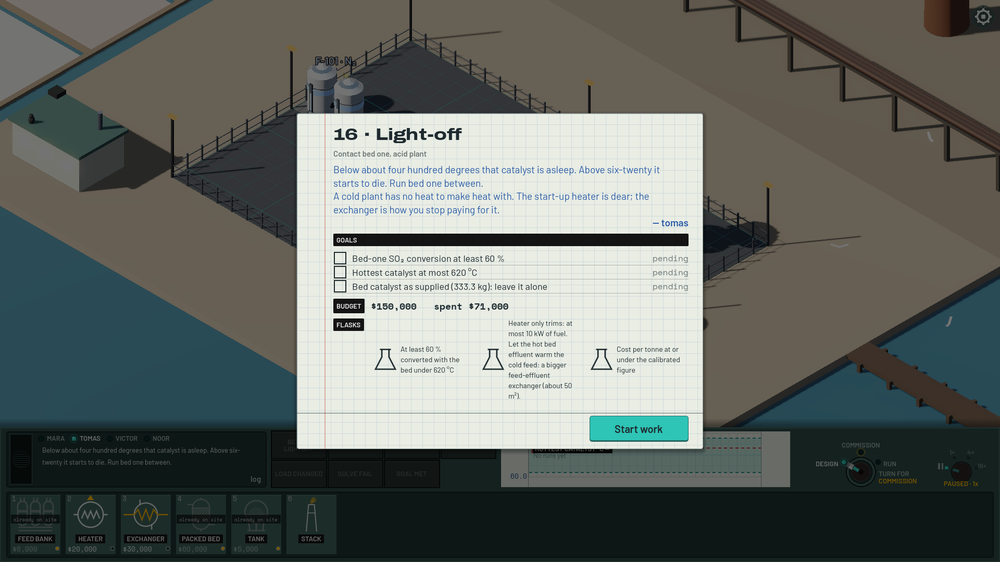 |
| **A run that went wrong: the printout says why (L01)** | **Runaway (L24): Semenov plot, running** |
|  |  |

## The control room and the boards (classic look)

| Tune It (L30): bump test, IMC, Nixie IAE | The Interlock (L33): sensors, votes, trip point |
|---|---|
|  |  |
| **HAZOP Node (L34)** | **The Analyser Lies (L37): data reconciliation** |
| 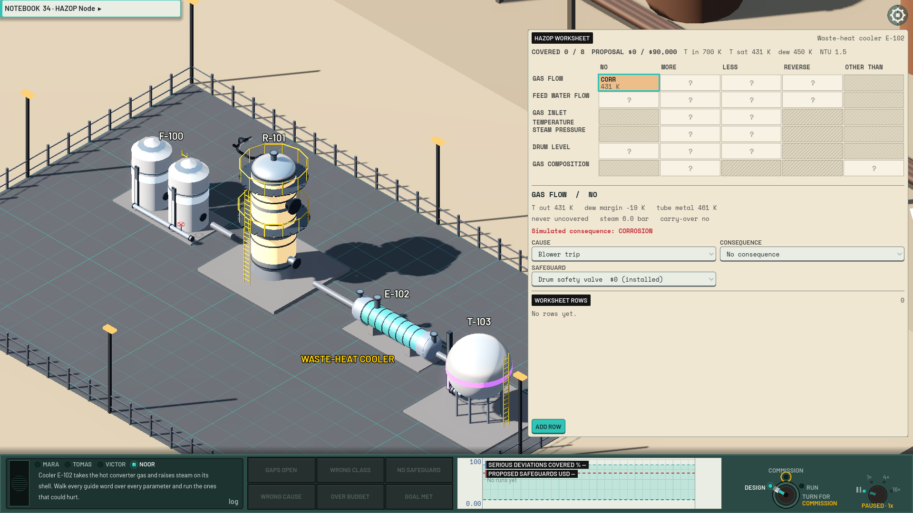 | 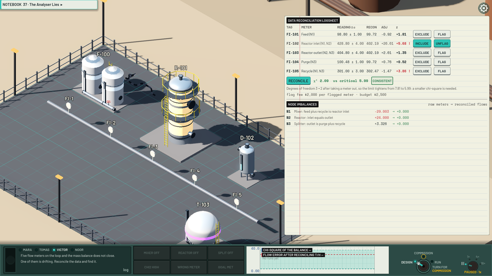 |

## Guidance you can follow

| The build order checklist (L24 start-up): every row ticks from the plant itself and stays up while the plant runs | Career: one decision a year, every option with the terms that make up its MUSD |
|---|---|
|  |  |

## The Works

| The Works Map | Career: year 2 of 5 |
|---|---|
|  | 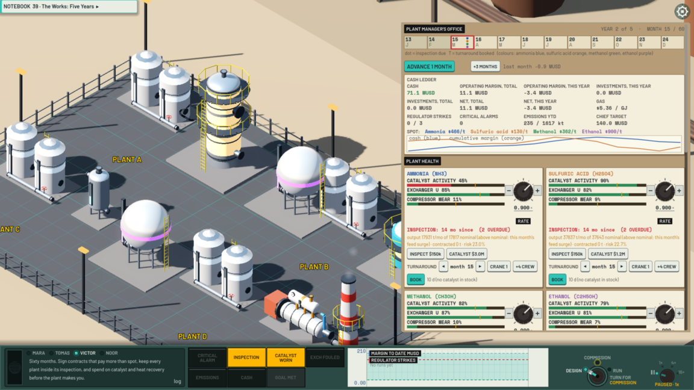 |

## On a Steam Deck

The handheld layout (1280×800) keeps the loop panel and the console on screen together.


## Download

**[Latest release](https://github.com/blackmetaltech/equilibrium/releases/latest)**: Linux (tar.gz), Windows (zip, untested) and macOS (zip, untested). Extract and run `EQUILIBRIUM/equilibrium.sh` or `EQUILIBRIUM\EQUILIBRIUM.exe`. Node.js is bundled.

macOS (untested): unzip, then right-click `EQUILIBRIUM.app` and choose Open (not signed by Apple; on macOS 15 and later: System Settings → Privacy & Security → Open Anyway). Universal (Apple silicon and Intel). Smoke-run on a Mac build server, never opened by a person on a Mac.

Android: a debug APK builds locally with `core/qa/buildapk.sh`.

## Run from source

Needs **Node.js 18+**, pnpm and **Godot 4.7**.

```sh
git clone --recursive <this repo>        # or: git submodule update --init
pnpm install
pnpm bridge                              # builds the engine sidecar -> godot/sidecar/bridge.mjs
godot --headless --path godot --import   # once, and after adding class_name scripts
godot --path godot                       # play
```

| task | command |
|---|---|
| typecheck | `pnpm typecheck` |
| unit, golden, persona and level tests | `pnpm test` |
| regenerate goldens (deliberate rule change only) | `GOLDEN_UPDATE=1 pnpm test` |
| UI smoke (every screen) | `pnpm smoke` (prints `SMOKE OK`) |
| screenshots and play-testers | `core/qa/README.md` |
| Android debug APK | `core/qa/buildapk.sh` (see `core/android/README.md`) |

Environment hooks for testing (`CB_AUTOSTART=learner`, `CB_LEVEL=L24`, `CB_CUTE=0|1`, `CB_SHOT=out.png`) are listed in `core/godot/addons/cobanana/README.md`. Where things go: `core/CORE.md`. Game design: [docs/DESIGN.md](docs/DESIGN.md).

## Architecture

```
core/        cobanana-core (git submodule): deterministic kit, Node bridge, Godot shell addon, Android runner, QA scripts
src/
  data/      species, reactions, kinetics, catalysts, equipment, VLE (generated from NIST / JANAF, provenance-tested)
  sim/       chem (equilibrium, kinetics), thermo, units, flowsheet (sequential-modular, Wegstein),
             dynamics, control (PID / FOPDT), ops, career, econ, explain
  engine/    actions, queries and the instrument queries the game calls
  levels/    one file per level (L00-L38, Career) with its tests; locales/en holds the text
  oracle/    JANAF and analytic fixtures
godot/       the game: main.gd, world/ (plant, pipes, critters, models), ui/ (console, faceplates, boards, instruments), tests/
docs/        DESIGN, DECISIONS, CRITIQUE-0.3 … CRITIQUE-0.7, readme screenshots, research
```

## Status and known gaps

0.9 ("The plant you can read") is tagged. The Career fixes from round 11 are in, the pump house and the incident are things in the plant, and a layout test walks every screen and level at 1920x1080 and 1280x800 for text under 16 px, clipping and overlap. Still open, from the [critique](docs/CRITIQUE-0.9.md) and `.work/backlog.md`:

- **Gamepad**: a pad-only pass at 1280x800 found the game only partly playable by pad (the notebook's call-it, the loop-panel knobs, the key switch, the speed dial and the Career's yearly choices are out of reach, and the focus ring is faint in places).
- **Career**: no careful human has finished all 60 months on this build, and the board still repeats the incident warning three times.
- **Phone**: checked on desktop at phone size only; the device needs the owner's adb authorisation.
- Releases are pre-releases: a Linux build (smoke-tested), a Windows zip (untested) and a macOS zip (smoke-run on a Mac build server, never opened by a person); the Android APK is a debug build.
